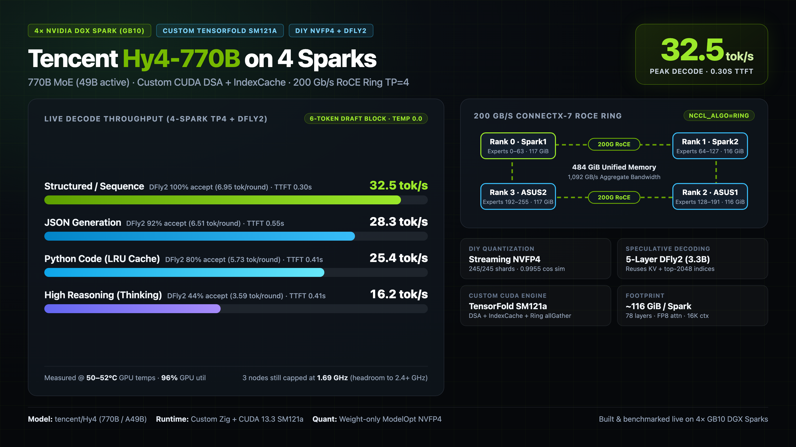

# Tencent Hy4 (770B MoE + DFly2) on 4× NVIDIA DGX Spark (GB10)



Run **[`tencent/Hy4`](https://huggingface.co/tencent/Hy4)** — the flagship **770B MoE (49B active) + 3.3B 5-layer DFly2 speculative drafter** — across **4× NVIDIA DGX Spark (GB10)** over a **200 Gb/s ConnectX-7 RoCE ring** at up to **32.5 tok/s** using a custom SM121a build of [TensorFold](https://github.com/ashhart/TensorFold) and a streaming GPU ModelOpt NVFP4 quantization.

- **Weights on Hugging Face:** [`spnichol/Hy4-NVFP4-DFly2`](https://huggingface.co/spnichol/Hy4-NVFP4-DFly2) *(pre-sharded per rank so each Spark only needs ~150 GB NVMe)*
- **Custom TensorFold Patch:** [`patches/0001-hy4-770b-cuda-dsa-ring-tp4.patch`](patches/0001-hy4-770b-cuda-dsa-ring-tp4.patch)
- **Streaming Quantizer:** [`scripts/quantize_hy4.py`](scripts/quantize_hy4.py)
- **OpenAI Tool-Call & Single-Stream Proxy:** [`scripts/hy4_omp_proxy.py`](scripts/hy4_omp_proxy.py)

---

## Live Measured Performance (4× GB10, TP=4, DFly2 `drafts=6`, `temp=0.0`)

| Workload | Mode | TTFT | DFly2 Accepted | Decode Speed |
| :--- | :---: | :---: | :---: | :---: |
| **Structured / Sequence** | `no_think` | `0.30s` | `258 / 258` (6.95 tok/round) | **32.48 tok/s** |
| **JSON Generation** | `no_think` | `0.55s` | `324 / 352` (6.51 tok/round) | **28.26 tok/s** |
| **Python Code (LRU Cache)** | `no_think` | `0.41s` | `316 / 397` (5.73 tok/round) | **25.40 tok/s** |
| **High Reasoning (Thinking)** | `high` | `0.41s` | `277 / 635` (3.59 tok/round) | **16.18 tok/s** |

*Measured at `50–52°C` GPU temps and `96%` GPU utilization (`asus1` at `2.39 GHz`, `spark1`/`spark2`/`asus2` capped at `1.69 GHz`). Footprint: `~116–117 GiB` unified memory per Spark at `16,384` context (up to `45,056` context fits in `119 GiB` / Spark).*

---

## Architecture & What's Custom

1. **Streaming GPU ModelOpt NVFP4 Quantization (`scripts/quantize_hy4.py`)**
   - Streams `tencent/Hy4-FP8` shard-by-shard (245 shards, ~774 GB total) directly into GPU memory, dequantizes 128×128 block FP8, and quantizes all **744.1B routed experts** + **3.25B shared/dense MLP** weights to exact ModelOpt NVFP4 (`uint8` E2M1 packed nibbles, `float8_e4m3fn` per-16 scales, `f32` global scale — **0.9955 cosine similarity**).
   - Dequantizes FP8 attention (`o_proj`, `linear_gate`) and 5-layer **DFly2** drafter weights to BF16 (TensorFold quantizes attention to FP8 E4M3 on GPU load via `TF_HY4_FP8=1`).
   - Splits routed experts directly into 4 rank buckets (`experts 0–63`, `64–127`, `128–191`, `192–255`), so you never need 1.5 TB of staging disk and each Spark only stores **~150 GB** locally.

2. **Custom SM121a TensorFold (`patches/0001-hy4-770b-cuda-dsa-ring-tp4.patch`)**
   - Built on [`atakann/TensorFold` (`hy4-flash` branch)](https://github.com/atakann/TensorFold/tree/hy4-flash) with Zig `0.17.0` and CUDA `13.3` (`-Dsm=121a -Dnative-fp-decode=true`).
   - Adds `hy_v4_vl` / `hy_v4` family support: 78 layers (1 dense + 77 MoE), 256 routed experts operating directly on `hidden_size=6144` (no latent bottleneck, no Engram, optional sandwich norms).
   - Adds custom CUDA kernels in `hy4_flash.cu`:
     - `tf_hy4_layernorm` (FP32 LayerNorm with BF16 weight + bias for `indexer.k_norm`)
     - `tf_hy4_dsa_scores` (Tensor-Core BF16 `mma.sync.aligned.m16n8k16` 32-head, dim-128 causal `ReLU(q · k) * w` scoring — 64 keys/CTA)
     - `tf_hy4_dsa_select` (8-bit radix top-2048 selector writing directly to `int32` token lists)
   - Implements **IndexCache** (reuses top-2048 indices from the 20 `"full"` indexer layers across the 58 `"shared"` layers).
   - Replaces cross-ring point-to-point `ncclSend`/`ncclRecv` in `serve.zig` with **Ring-safe `allGather`**, enabling zero-switch **4-node 200 Gb/s ConnectX-7 RoCE rings** (`NCCL_ALGO=Ring`).
   - Dispatches `g.decode()` (SM121a warp-specialized NVFP4 MoE decode kernel) for `n <= 16` and matches `drafts = 6` / `verify_rows = 7` to Hy4's native `dfly_block_size = 7`.

---

## Quickstart

### 1. Build Custom TensorFold (`tensorfold-native`)

Requires Zig `0.17.0` and CUDA `13.2+` (e.g. inside `nvcr.io/nvidia/pytorch:26.07-py3` or a CUDA 13.3 container):

```bash
git clone --depth 1 -b hy4-flash https://github.com/atakann/TensorFold.git
cd TensorFold
git apply /path/to/patches/0001-hy4-770b-cuda-dsa-ring-tp4.patch

zig build native -Doptimize=ReleaseFast \
  -Dnvcc=/usr/local/cuda/bin/nvcc \
  -Dsm=121a \
  -Dnative-fp-decode=true
```

Copy `zig-out/native/bin/tensorfold-native` to all 4 Sparks.

### 2. Get or Quantize the Weights

**Option A — Download pre-sharded weights from Hugging Face:**
Download [`spnichol/Hy4-NVFP4-DFly2`](https://huggingface.co/spnichol/Hy4-NVFP4-DFly2) (each rank needs `meta/*`, `common-*`, and its own `rank{r}-*` shards plus `rank{r}_index.json` renamed to `model.safetensors.index.json`).

**Option B — Stream-quantize directly from `tencent/Hy4-FP8`:**
```bash
# Can be split across two Sparks (e.g. --shards 1-122 and --shards 123-245)
python3 scripts/quantize_hy4.py --out ~/hy4-770b/Hy4-NVFP4-sharded --dl-chunks 16
```

### 3. Launch Across a 4-Spark 200G RoCE Ring

Align ranks `0 → 1 → 2 → 3 → 0` to your physical ConnectX-7 ring cables, then launch with [`scripts/launch_tp4_ring.sh`](scripts/launch_tp4_ring.sh):

```bash
./scripts/launch_tp4_ring.sh
```

Query the OpenAI-compatible API on Rank 0 (`:8895`), or run [`scripts/hy4_omp_proxy.py`](scripts/hy4_omp_proxy.py) on `:8896` if your client (e.g. OMP) needs standard OpenAI `tool_calls` translation from Hy4's `<tool_calls:opensource>` XML and request serialization for single-stream serving:
```bash
# Optional local proxy for OpenAI tool_calls + single-stream serialization
HY4_UPSTREAM=http://<rank0-ip>:8895 HY4_DEFAULT_TEMP=0.3 python3 scripts/hy4_omp_proxy.py

curl -s http://<rank0-ip>:8895/v1/chat/completions \
  -H 'Content-Type: application/json' \
  -d '{
    "model": "hy4",
    "messages": [{"role": "user", "content": "Write a Python LRU cache with O(1) get and put."}],
    "chat_template_kwargs": {"reasoning_effort": "no_think"},
    "max_tokens": 512
  }'
```

---

## License

- Recipe scripts and patches in this repository are MIT / Apache-2.0 (matching TensorFold).
- Model weights derive from `tencent/Hy4` and remain subject to the **Tencent Hy License**.
